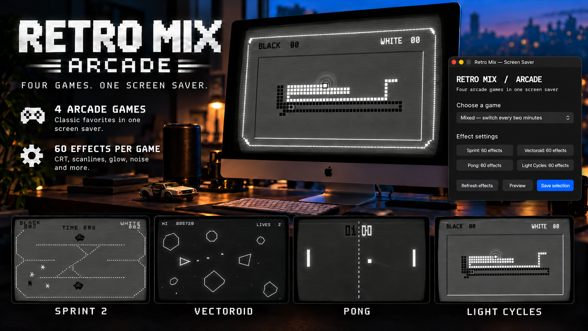

# Retro Mix Arcade

Retro Mix Arcade is a macOS screen saver featuring four autonomous arcade
games: Sprint 2, Vectoroid, Pong, and Light Cycles. Choose a game or select
**Mixed** to rotate between them every two minutes with a CRT tuning
transition. The games share Sprint's monochrome display style and common CRT
effects, and each game has its own visual options.

## Download and install

Download the ZIP from [Releases](https://github.com/mikaelmoran/retro-mix-arcade-downloads/releases), expand it, and move
**Retro Mix Arcade.app** to Applications. Open the app, choose a game, and
click **Save selection**. In **System Settings → Wallpaper → Screen Saver**,
choose **RetroMixModern**.

The app requires macOS 14 or newer and includes Apple Silicon and Intel code.
This build is locally signed and has not been notarized by Apple. If macOS
blocks it, try opening the app once, then use **System Settings → Privacy &
Security → Open Anyway** as described in [Apple's instructions](https://support.apple.com/en-us/102445).

## Features

- Four games played by autonomous opponents.
- A mixed mode with smooth CRT transitions.
- Sprint's shared scanlines, glow, curvature, flicker, noise, RGB split, and
  other screen effects across all games.
- Separate game-specific effect controls, including 60 Sprint effects.
- A preview that follows the currently selected game.
- A moving JMR watermark that can be removed with a personal code from the
  [$5 unlock item](https://buymeacoffee.com/mikaelmoran/e/585964).

## Gameplay captures

| Sprint 2 | Vectoroid | Pong | Light Cycles |
| --- | --- | --- | --- |
|  |  |  |  |

This repository contains downloads and documentation. Third-party license
information is in [THIRD_PARTY_NOTICES.md](THIRD_PARTY_NOTICES.md).
