# Retro Mix Arcade

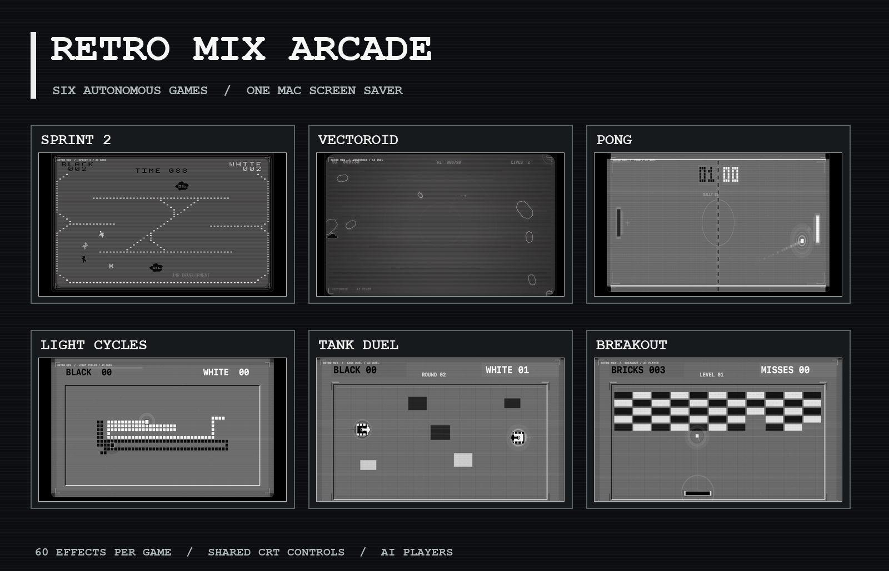

Retro Mix Arcade is a macOS screen saver featuring ten autonomous arcade
games: Sprint 2, Vectoroid, Pong, Light Cycles, Tank Duel, Breakout,
Moonlander, Missile Defense, Star Squadron, and Maze Chase. Choose
a game or select
**Mixed** to rotate between them every two minutes with a CRT tuning
transition. The games share Sprint's monochrome display style and common CRT
effects, and each game has its own visual options. Hits and crashes light the
shared CRT frame, while a live channel display and signal sweep connect all
ten games visually.

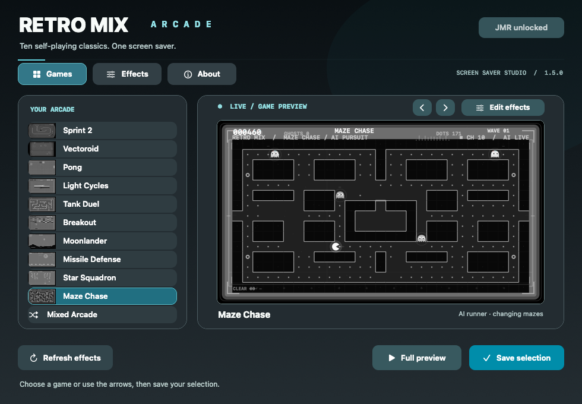

The settings app plays the selected game live. Choose from the **Games** list
or use the arrows above the display, then click **Save selection** to apply it
to the screen saver. **Full preview** opens a larger window; **Effects** opens
each game's visual options. The image shows an already unlocked JMR license.

## Download and install

Download the ZIP from [Releases](https://github.com/mikaelmoran/retro-mix-arcade-downloads/releases), expand it, and move
**Retro Mix Arcade.app** to Applications. Open the app, choose a game, and
click **Save selection**. In **System Settings → Wallpaper → Screen Saver**,
choose **Retro Mix Arcade**.

Click **Options…** in System Settings to choose a game there. **Save & close**
applies the choice and closes the sheet. **Open full settings…** opens the app
for the live preview and all effect controls.

If you also use the standalone Sprint 2 app, open Retro Mix Arcade or click
**Refresh effects** there to import newer Sprint effect settings.

The app requires macOS 14 or newer and includes Apple Silicon and Intel code.
This build is locally signed and has not been notarized by Apple. If macOS
blocks it, try opening the app once, then use **System Settings → Privacy &
Security → Open Anyway** as described in [Apple's instructions](https://support.apple.com/en-us/102445).

## Features

- Ten games played by autonomous opponents.
- A mixed mode with smooth CRT transitions.
- Sprint-style CRT glass, scanlines, glow, curvature, flicker, noise, RGB split,
  and other screen effects across all games.
- Separate game-specific effect controls, including 60 Sprint effects.
- A preview that follows the currently selected game.
- Computer-controlled players with individual styles, brief reaction times,
  tactical commitments, and occasional recoverable errors.
- Sprint drivers hold overtaking lines, reach much higher speeds on straights,
  and plan braking before corners. The Vectoroid pilot prioritizes threats,
  dodges, and fires in bursts.
- Pong players correct their ball reads and choose corner, bank, and
  change-of-pace shots. Light Cycles riders balance territory and pressure.
- Tank Duel opponents remember recent sightings, use cover, and correct their
  aim; Breakout's paddle prioritizes incoming balls and targets brick lanes.
- Moonlander's AI pilot manages thrust, sideways drift, fuel, and changing
  landing sites. Later missions add rugged ridges and cavern routes with two
  or three alternating openings before a narrow landing pad.
- Missile Defense carries city damage across waves and adds splitting and
  evasive missiles, destructible batteries, and wave bonuses. Star Squadron
  has distinct enemies, looping dives, challenge stages, a tractor beam, and
  a rescuable second fighter. Maze Chase has a mirrored maze, center ghost
  house, side tunnel, bonus fruit, four smoothly animated hunters with
  different targets, and a pellet-clearing player that pursues frightened
  ghosts.
  These games are inspired by Missile Command, Galaga, and Pac-Man respectively.
- Tank Duel's dark field, bright walls, small rotating tanks, and simple score
  display take cues from the original arcade game.
- A moving JMR watermark that can be removed with a personal code from the
  [$5 unlock item](https://buymeacoffee.com/mikaelmoran/e/585964).

## Gameplay captures

| Sprint 2 | Vectoroid | Pong |
| --- | --- | --- |
| 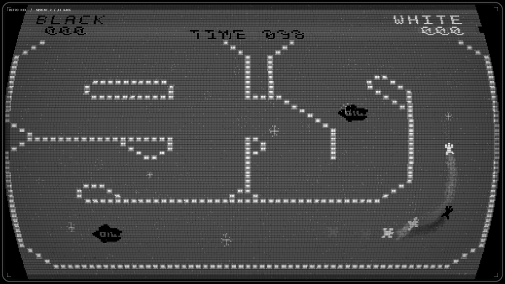 | 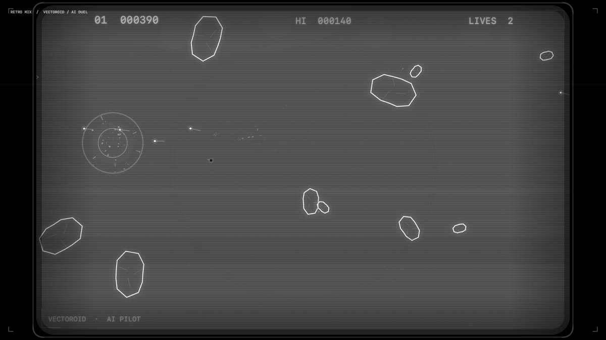 | 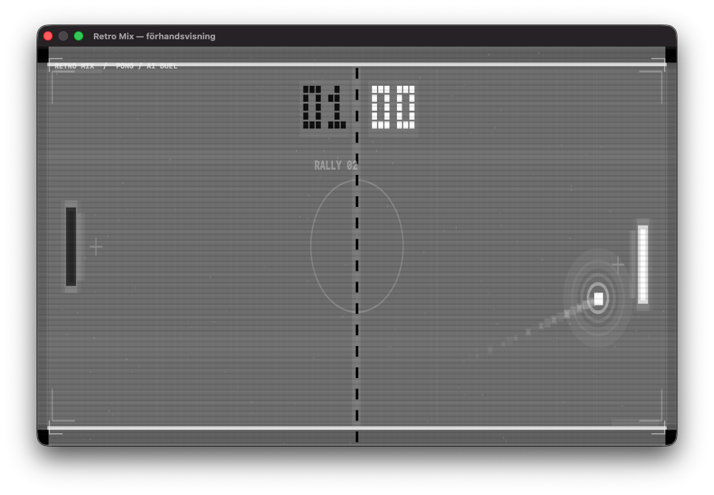 |

| Light Cycles | Tank Duel | Breakout |
| --- | --- | --- |
| 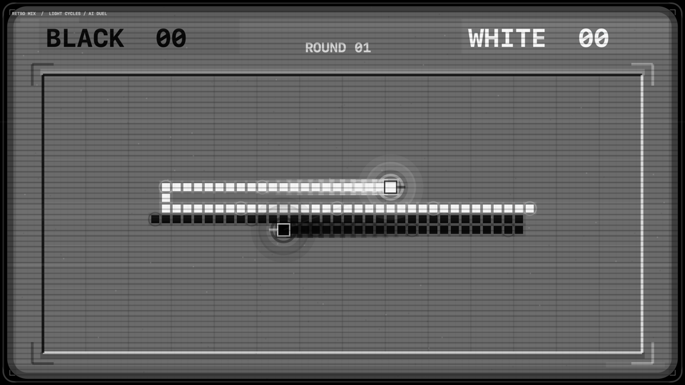 | 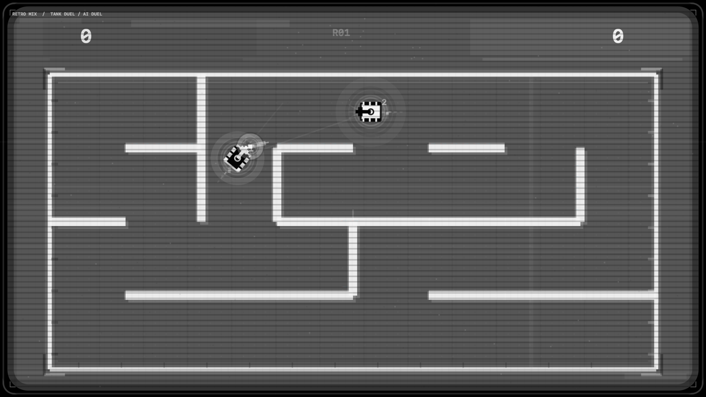 | 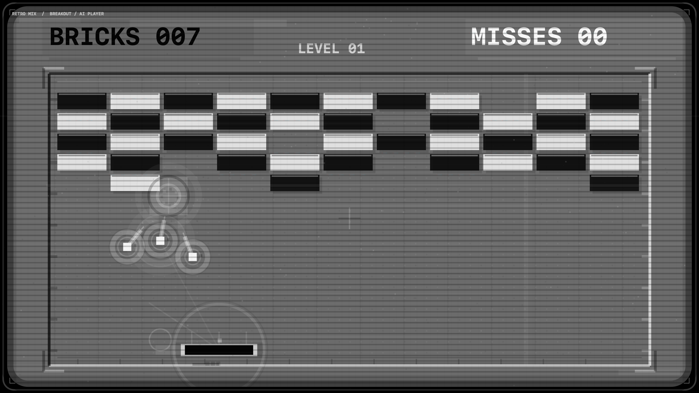 |

| Moonlander |
| --- |
| 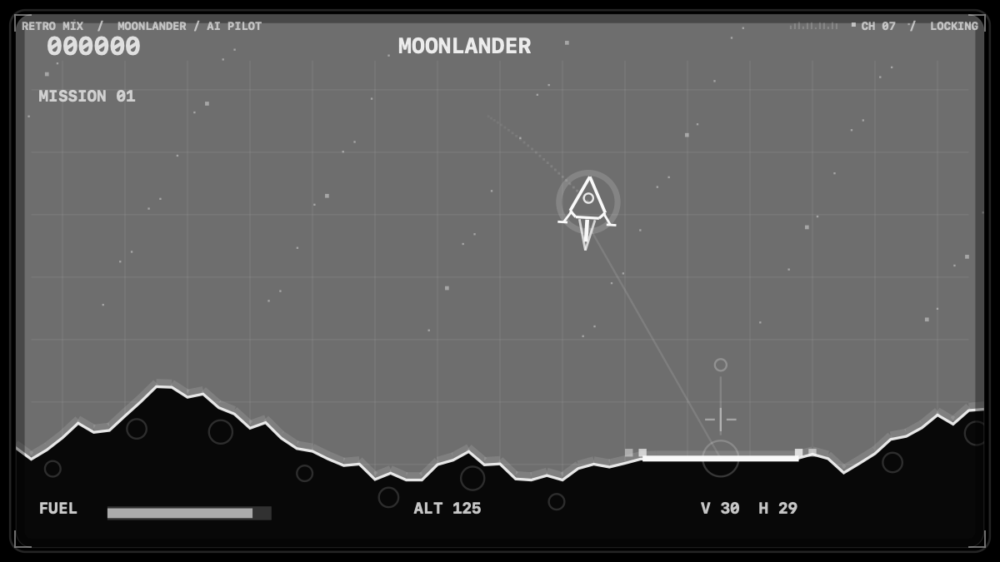 |

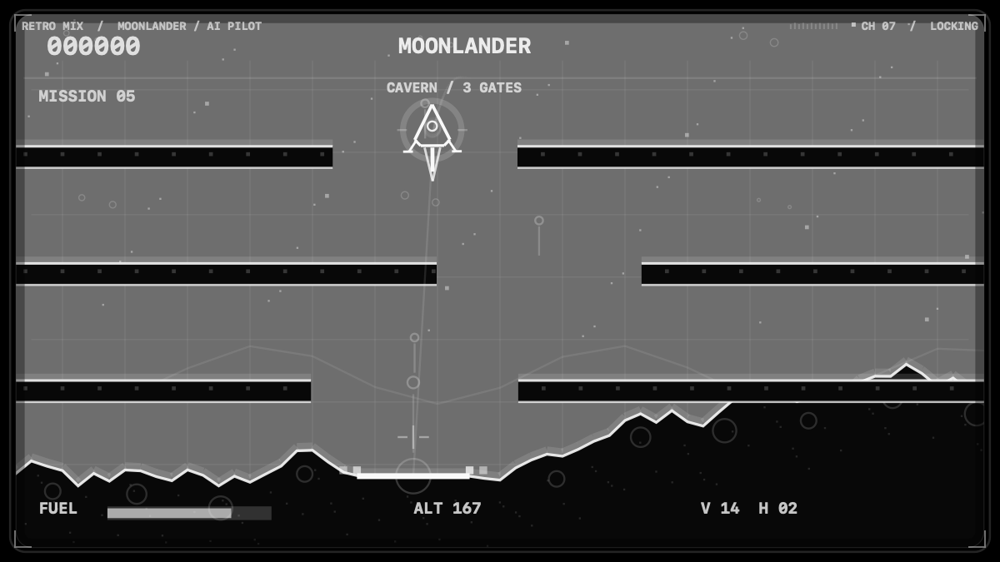

| Missile Defense | Star Squadron | Maze Chase |
| --- | --- | --- |
| 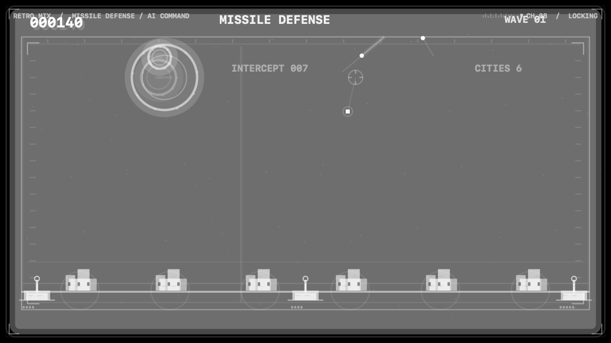 | 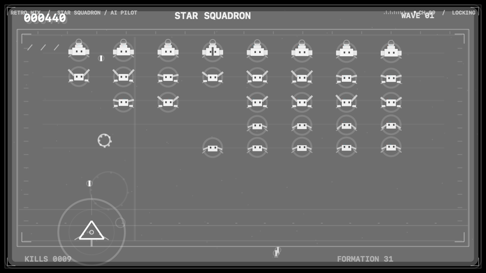 | 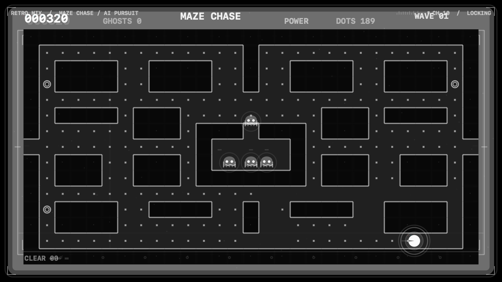 |

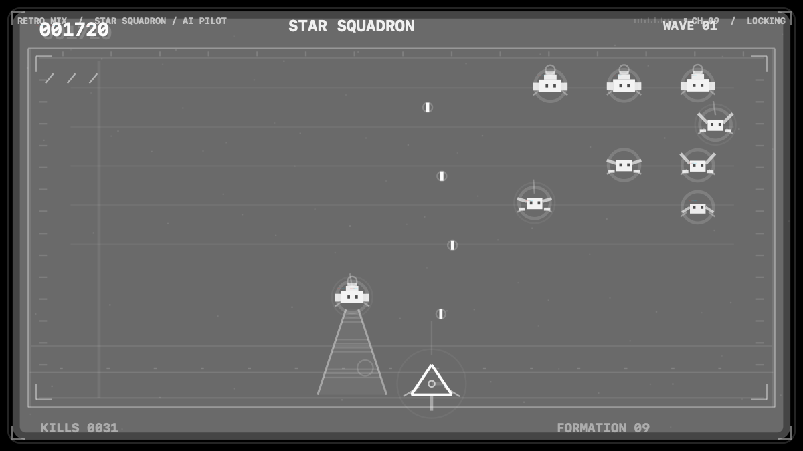

This repository contains downloads and documentation. Third-party license
information is in [THIRD_PARTY_NOTICES.md](THIRD_PARTY_NOTICES.md).
